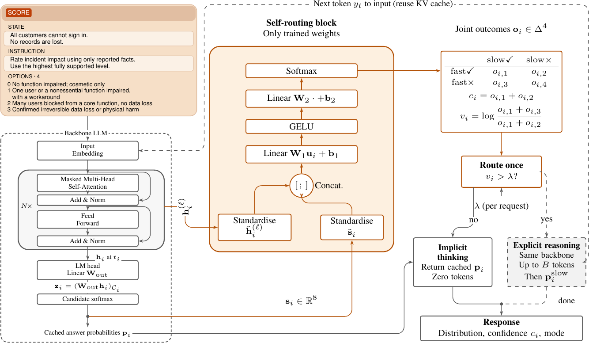
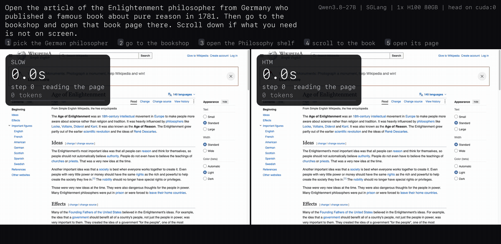
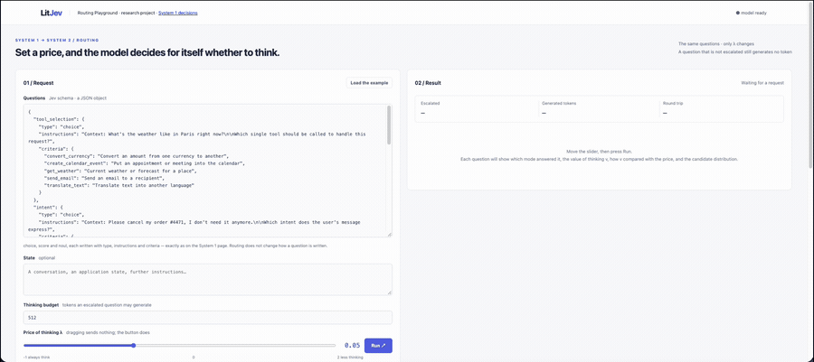

<div align="center">

# HDM &nbsp;·&nbsp; a hybrid decision model

**Official implementation of**
### [The Value of Thinking: Learning When to Reason in Hybrid Decision Models](https://arxiv.org/abs/2611.16961)

[](LICENSE)
[](pyproject.toml)
[](https://arxiv.org/abs/2611.16961)
[](https://huggingface.co/fredreick/HDM-blocks)

*One backbone, two decision modes, and a learned block that prices thinking
before either mode runs.*

</div>

---

<div align="center">

</div>

<div align="center">
<sub><b>Where the block sits.</b> The frozen backbone encodes a typed request with no token
generated. The self-routing block holds the only trained weights: it reads the readout state
and eight statistics of the fast answer, and returns the joint outcome of the two modes, from
which the confidence <code>c<sub>i</sub></code> and the value of thinking <code>v<sub>i</sub></code>
follow. Routing happens once, before either mode runs.</sub>
</div>

---

## What this is

The **fast mode** generates no token: one forward pass encodes the request and the
answer is read from the candidate distribution at the readout position. The **slow
mode** is the backbone's own reasoning, inherited unchanged. The **self-routing
block**, a few hundred kilobytes, estimates what thinking is worth on this question
and escalates only when that value clears a price the caller sets per request.

A question therefore costs either **no generated token** or the **T** a reasoning
pass takes. Nothing in between, and nothing is parsed out of generated text.

> The value of thinking is a log ratio, `log P(slow right) / P(fast right)`, not a
> difference. The reward discounts tokens rather than subtracting them, and a
> difference shrinks exactly where thinking is worth most.

## Routing on a live task

<div align="center">

</div>

<div align="center">
<sub>One task, three policies, one clock: never thinking, always thinking, and the block
deciding per step. <code>demo/</code> has the harness.</sub>
</div>

## Quick start

Python 3.11 or newer, and a GPU with room for the backbone (the 4B needs about
8 GB in bf16, plus its KV cache).

```bash
git clone https://github.com/zhengxuyu/HDM-code
cd HDM-code
uv sync                                   # or: pip install -e .

huggingface-cli download fredreick/HDM-blocks \
    head-4b-mmlu-pro.safetensors --local-dir weights/

litjev-serve --model Qwen/Qwen3.5-4B \
             --decision-head weights/head-4b-mmlu-pro.safetensors \
             --readout coded --port 8000
```

The checkpoint downloads on the first call, so the first request is slow and the
rest are not. Then open <http://127.0.0.1:8000>:

| page | what it shows |
|---|---|
| `/` | one typed request answered by the fast mode: the distribution and the confidence, with no token generated |
| `/routing` | the same request at several prices side by side, so you can see where the block escalates and what it costs |
| `/health` | whether weights are loaded |

Drop `--decision-head` and the fast mode still answers; there is simply nothing
to route on, and `/routing` will say so.

<div align="center">

</div>

<div align="center">
<sub>The page at work. One request, a price on the dial, and per question: the value of
thinking, the fast mode's confidence, and how the two compared. A question whose value
clears the price is answered by the slow mode; the rest are answered at no generated
token. Recorded at twice speed.</sub>
</div>

On a GPU large enough for the 27B, the slow mode is far faster through SGLang:

```bash
litjev-serve --model /path/to/Qwen3.8-27B \
             --decision-head weights/head-27b-mmlu-pro.safetensors \
             --backend sglang --readout coded --preload --port 8000
```

`--readout` has to be the one the block was fitted under, and the server refuses a
block fitted for another backbone rather than reading noise.

> **The playground has no authentication.** The server binds `127.0.0.1` for that
> reason. To reach it from elsewhere, forward the port
> (`ssh -N -L 8000:<node>:8000 <user>@<host>`) rather than passing `--host 0.0.0.0`.

[`docs/deploy.md`](docs/deploy.md) has the rest: verifying the engine returns what
the block was trained on, running the decision service for agent loops, and
containers.

## The API

`POST /v1/systemone` answers with the fast mode alone. `POST /v1/systemtwo` takes a
routing block in the body and decides for itself:

```json
{"model": "litjev",
 "state": "All customers cannot sign in. No records are lost.",
 "questions": {"impact": {"type": "score", "instructions": "...", "criteria": ["..."]}},
 "routing": {"lambda": 0.0, "budget": 4096}}
```

`lambda` is the price of one escalation, and it is **not** baked into the block:
training draws a price per example, so one fit serves every price and moving it
moves the operating point along the cost-accuracy curve without retraining.
`budget` caps the slow mode at B generated tokens.

## Repository

| | |
|---|---|
| `src/litjev/` | the two modes: typed requests, readouts, the block, the pipeline |
| `src/inference/` | SGLang backend, the decision service, and its standard-library client |
| `src/slime_htm/` | episodic rollouts, the environment protocol, CDPO |
| `demo/` | one browser task under three policies, on the clock |
| `docs/` | the API, the schema, how the readouts work, how to reproduce |

## Routing inside an agent loop

For step-level decisions the engine, the tokenizer and the block sit together, and
only the decision crosses the network:

```bash
python -m inference.decision_service \
       --model Qwen/Qwen3.5-4B --head weights/head-4b-mmlu-pro.safetensors
```

| route | what it returns |
|---|---|
| `POST /fast` | the action distribution, with the value of thinking and the confidence beside it |
| `POST /slow` | reasons first, then reads the same candidates |
| `POST /solve` | lets the slow mode write an action where the environment can take one |
| `GET /health` | which block is loaded, down to a digest of its weights |

`inference.client.DecisionClient` is standard library only, so an environment with
its own dependencies can talk to the service without carrying torch.

## The blocks

The blocks live on the Hub, at
[**fredreick/HDM-blocks**](https://huggingface.co/fredreick/HDM-blocks), rather than
in this repository, so there is one copy of them and one place that records what
they were fitted on:

```bash
huggingface-cli download fredreick/HDM-blocks \
    head-4b-mmlu-pro.safetensors --local-dir weights/
```

| | `head-4b-mmlu-pro` | `head-27b-mmlu-pro` |
|---|---|---|
| backbone | Qwen3.5-4B | Qwen3.8-27B |
| readout / layer | `coded` / `-1`, raw | `coded` / `-1`, raw |
| fitted on | MMLU-Pro, 1,154 questions | MMLU-Pro, 1,154 questions |
| held out | 346, whole categories | 346, whole categories |
| AUROC, where thinking helps | 0.804 | 0.879 |

Fitted once and used unchanged everywhere else. The
[model card](https://huggingface.co/fredreick/HDM-blocks) records what they were
fitted on, and the two places where a simpler rule scores higher.

## Citation

```bibtex
@article{yu2026valueofthinking,
  title         = {The Value of Thinking: Learning When to Reason in Hybrid Decision Models},
  author        = {Yu, Zhengxu and Xu, Ke and Fang, Meng and Ammar, Haitham and
                   Luo, Weilin and Wang, Jun},
  journal       = {arXiv preprint arXiv:2611.16961},
  year          = {2026},
  eprint        = {2611.16961},
  archivePrefix = {arXiv},
  primaryClass  = {cs.AI}
}
```

## Licence

Apache 2.0, see [`LICENSE`](LICENSE). Third-party notices are in
[`THIRD_PARTY_NOTICES.md`](THIRD_PARTY_NOTICES.md).
